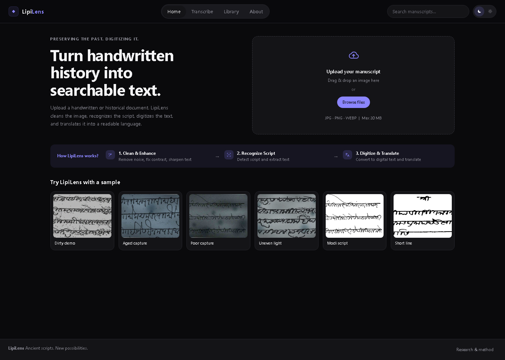
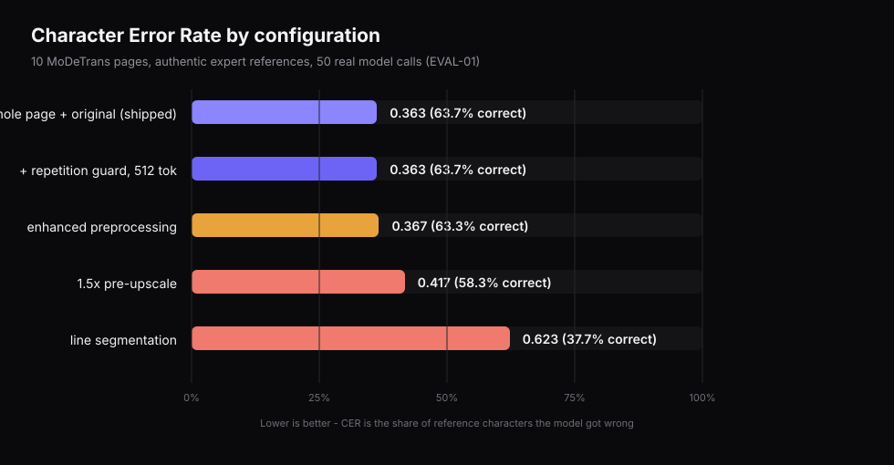
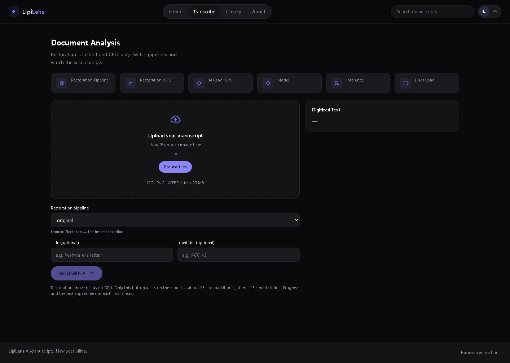
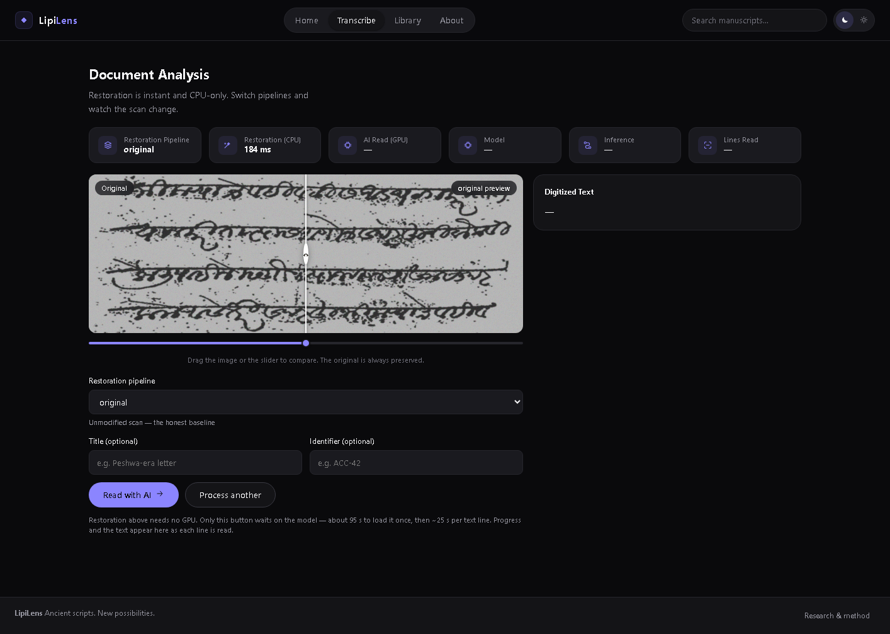
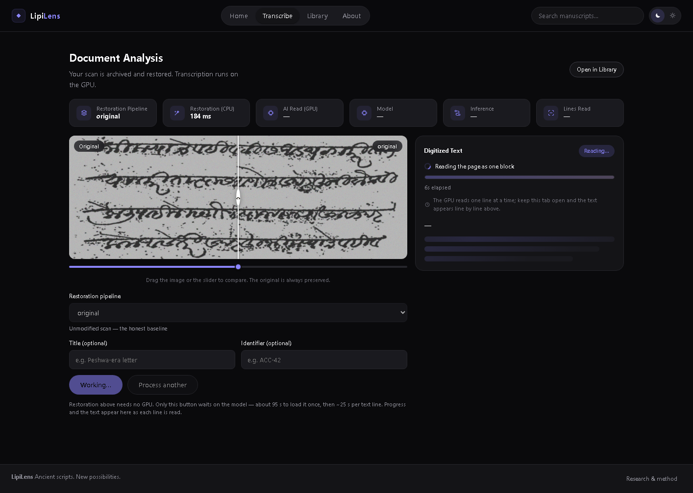
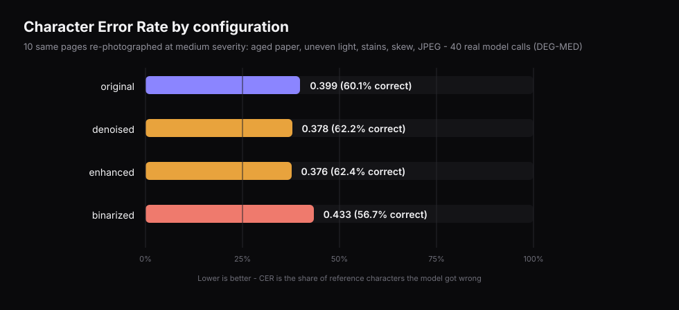
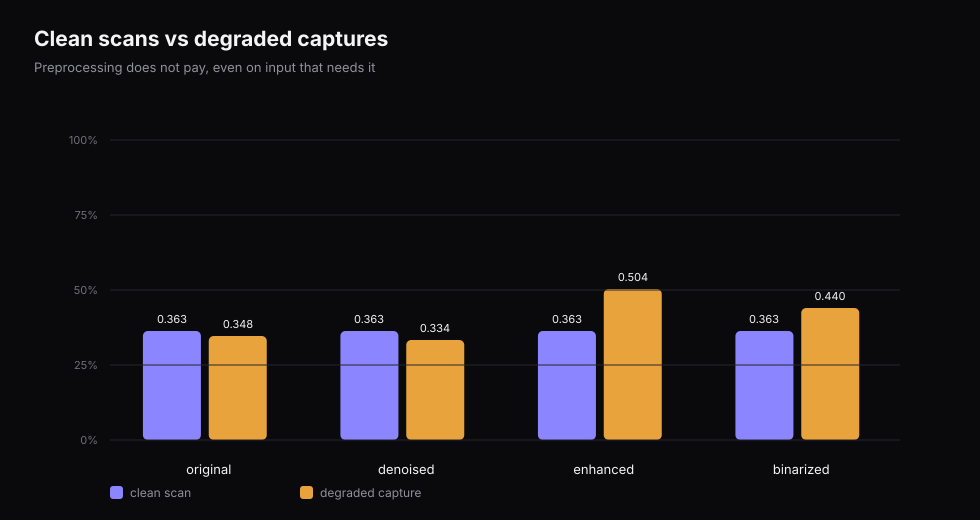
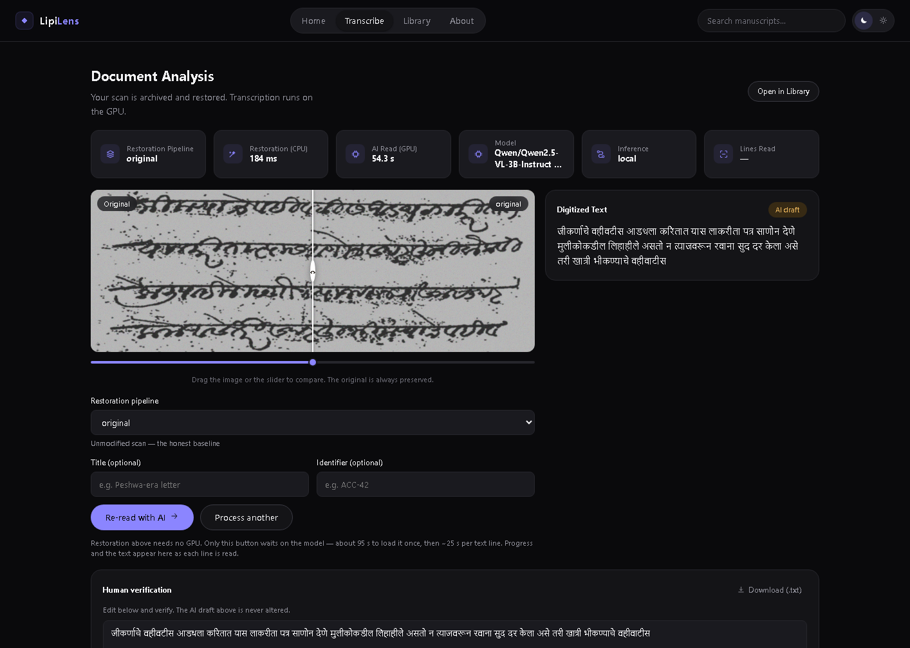
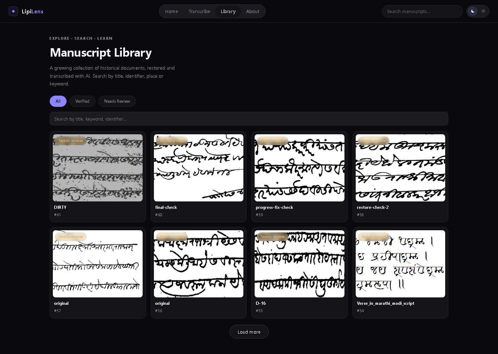

# LipiLens — Team Brief

**Status: working, measured, and honestly documented.**
Date: 2026-10-08 · Branch `main` @ `ae4a716` · 93 tests passing

---

## 1. What LipiLens is

LipiLens turns a photograph of a handwritten **Modi-script** manuscript into
searchable **Devanagari** text, with a human verification step in between.

Modi is the cursive administrative script of Maharashtra, used from roughly the
13th century to the mid-20th. It has no word spaces and a heavy headline
(`shirorekha`) joining characters into continuous runs. Most surviving documents
are administrative, legal and correspondence records — the kind of paperwork
that holds property, tax and court history.

The task is **transliteration, not translation**: the Marathi language does not
change, only the script. So the output is directly usable by a Marathi reader.

---

## 2. The one-paragraph version

The product is a **human-in-the-loop transcription aid**. A 3-billion-parameter
vision-language model, quantised to 4-bit so it fits on a 4 GB consumer GPU,
produces a first-draft Devanagari reading at **63.7% character accuracy**. A
reviewer then corrects roughly one character in three using an in-app
verification panel. That is the design, not a workaround: the published
adapter we build on reports the same ceiling, and its authors describe it as a
first draft for expert review.



> **Do not claim 75–80% accuracy.** That figure is the top ~15% of the
> adapter's published distribution and requires more VRAM than this machine
> has. Claiming it would be a number we cannot defend.

---

## 3. The numbers

| Measure | Value |
|---|---|
| Character accuracy, clean scans | **63.7%** (CER 0.363) |
| Character accuracy, degraded captures | **62.4%** (CER 0.376) |
| Published adapter mean, 204 held-out pages | 67.2% (CER 0.328) |
| Hardware | RTX 2050, **4 GB VRAM** (adapter recommends ≥6 GB) |
| Time per page | ~55–120 s (first page adds ~85 s model load) |
| Tests | 93 passing |

### Accuracy by configuration — clean scans



Lower is better. Only the top bar is shipped.

---

## 4. What was wrong, and what we found

This section is the honest part. Three of our own beliefs were wrong and got
corrected by measurement.

### 4.1 The app appeared to do nothing

**Symptom.** A page was uploaded, the button changed state, and then minutes of
silence before an error. No progress, no result.

**Two independent causes, both confirmed:**

1. **A client-side abort.** The frontend applied a 120-second timeout to
   *every* request. A page takes ~85 s to load the model plus ~25 s per text
   line, so the browser gave up while the server was still working. Restoration
   — a ~100 ms CPU operation — always looked fine, which is why only the AI
   step was affected.
2. **Silently discarded clicks.** The re-entrancy latch was seeded from the
   "auto file" prop. Arriving from the Home page — the hero dropzone *and* the
   sample strip, i.e. the primary entry points — left the latch stuck closed.
   Every click returned before issuing any request: no upload, no error, no
   way out short of choosing a file on a different tab.



A scan loaded, with the restoration preview live. Restoration is CPU-only and
returns in ~184 ms — it never waits on the GPU, so this step is always instant.



### 4.2 Transcription "produced nothing"

**Symptom.** Results looked like fluent but invented Marathi — confident,
plausible, wrong.

**Cause.** Not the model. The archive's own rows proved it: on two pages where
line-detection happened to return a single band, the model scored CER 0.343 and
0.348 with visibly correct names and phrases. Wherever line detection split the
page, CER collapsed to 0.74–0.87.

Line segmentation was added to raise the visual-token budget. **Measured, it
cost 0.363 → 0.623.** It now defaults to off.

---

## 5. Architecture

```
   Browser (React 19 + Vite, :5173)
        │
        │  1. POST /api/manuscripts        (multipart, config, title)
        │  2. POST /api/manuscripts/{id}/transcribe   → 202 immediately
        │  3. GET  /api/manuscripts/{id}/progress     → polled every 1 s
        ▼
   FastAPI (:8000)
        │
        ├── RESTORATION (OpenCV, CPU)  ──►  restored.png
        │      7 named configs, stage-level, independently tested
        │
        ├── TRANSCRIPTION (GPU, background thread)
        │      Qwen2.5-VL-3B-Instruct + Modi LoRA, 4-bit NF4
        │      reports progress: loading_model → reading → done
        │
        └── ARCHIVE (SQLite + SQLAlchemy)
               ai_transcription is immutable;
               verification writes a separate column
```

### The job model

Transcription is the only slow act, so it does not block a request.
`POST /transcribe` starts a background thread and returns **202** immediately.
The browser then polls `/progress` once a second for stage, percentage, elapsed
time and the text read so far. The archive row is still written exactly once,
atomically, at the end.



This is what the bar is showing: a real measurement from a real run, not an
animation.

---

## 6. The accuracy investigation

### 6.1 Method

`scripts/evaluate_local.py` runs the **real** pipeline — restoration included —
against MoDeTrans pages from IIT Roorkee / MIT with authentic expert
Devanagari references. It keeps every hypothesis on disk, so any row in this
report can be re-scored without a GPU:

```bash
python scripts/evaluate_local.py --report \
    --configs original denoised enhanced --tag DEG-MED
```

90 model calls across two experiments. Run-to-run variance on 10 pages is about
**±0.05 CER**, so smaller differences are noise and are labelled as such.

### 6.2 Finding 1 — the shipped configuration


- Whole page, `original`, no segmentation → **63.7%** — shipped.
- Repetition guard + 512-token cap → **byte-identical output.** Harmless, but
  not a win. We had assumed it would help; it did nothing.
- 1.5× pre-upscale → **worse** (58.3%). We had ranked this the highest-value
  available lever. The GPU disagreed.
- Line segmentation → **much worse** (37.7%).

The segmentation failure was not a small tuning miss. Its band detector cut
ascenders and matras off every line and fed the model fragments at 23:1–40:1
aspect ratios. We repaired the geometry — full-line padding, an aspect-ratio
clamp, a config-driven pixel budget — and it measured **0.623** anyway.
Segmentation is simply the wrong strategy for this task.

### 6.3 Finding 2 — preprocessing earns a little, but only on dirty input



`make_realistic.py` re-photographs authentic pages — aged paper, uneven
lighting, foxing stains, skew, JPEG artefacts — keeping the **authentic script
and authentic ground truth**. Only the capture is simulated.

| Config | Clean scan | Degraded capture |
|---|---|---|
| `original` | **63.7%** | 60.1% |
| `denoised` | — | 62.2% |
| `enhanced` | 63.3% | **62.4%** |
| `binarized` | — | **56.7%** |



The product thesis — *dirty scan in, clean text out* — is **directionally right
and small**. Cleaning buys ~2 points on a degraded capture and costs ~0.4 on a
clean one. **Binarisation loses in every condition tested** and is not reachable
from the default UI path.

Note this refines our earlier claim: we had said denoising "destroys the thin
Modi matras". Measured, deletions moved only 3.5% → 3.9%. That story was
overstated; we corrected it.

### 6.4 Why 75–80% is out of reach here

The published adapter reports, on 204 held-out pages:

| Quality tier | CER | Share |
|---|---|---|
| Good | 0.10–0.20 | 19% |
| **Fair** | **0.20–0.40** | **53%** |
| Poor or worse | >0.40 | 24% |

Mean **0.328**. Holding 0.20–0.25 *on average* means beating the adapter's own
held-out distribution. It was developed on an 8.5 GB GPU and recommends ≥6 GB;
we run on 4 GB and the harness measured ~3.9 GB of 4 GB in use during
inference. No preprocessing change moves this by more than a couple of points.

---

## 7. Results



Real run: 54.3 s, model `Qwen/Qwen2.5-VL-3B-Instruct`, inference `local`, and a
Devanagari draft ready for review.



Every transcription is archived, searchable, and carries its model name and
inference mode.

---

## 8. Honest limitations

- **Single-user, no auth.** Do not expose publicly.
- **±0.05 CER is noise on 10-page runs.** Re-run before quoting any single
  number. Do not present a 0.01 difference as a result.
- **Most earlier work was unscorable.** 8 of the 18 local transcriptions in the
  archive had no ground truth. An unscored run is not a result — that is why
  the harness exists.
- **Whole-page reads have no line denominator,** so the progress bar sweeps
  without a percentage during the read. Deliberate: it will not invent a number.
- **Progress is per-process and in-memory.** A server restart loses the live
  view, not the result. Multiple workers would need it in the database.
- **One GPU process at a time.** The API server keeps the model resident; a
  second process loading it exhausts the card and kills the CUDA context. Stop
  the server before offline evaluation.
- **The degraded set is simulated damage on authentic text.** It is a controlled
  degradation, never a real photograph, and should not be presented as one.
- **This is a draft, not a reading.** At 63.7% a human corrects about one
  character in three. The verification panel exists for exactly that.

---

## 9. Running it

```bash
# terminal 1 — API
.venv\Scripts\python -m uvicorn backend.main:app --port 8000

# terminal 2 — UI
cd frontend && npm install && npm run dev      # http://localhost:5173
```

Verify: `GET /api/health` → `"status": "ok"`, and
`python -m pytest tests/ -q` → 93 passed.

In local mode the model loads lazily, so a fresh server reports
`"model_loaded": false` until the first transcription. That is healthy.

| Variable | Default | Purpose |
|---|---|---|
| `INFERENCE_MODE` | `local` | `local` or `colab` |
| `SEGMENT_LINES` | `0` | **Off** — measured harmful (0.363 → 0.623) |
| `MAX_MODEL_PIXELS` | `1280*28*28` | Processor pixel budget |
| `REPETITION_PENALTY` | `1.05` | Greedy decoding loops; `1.0` disables |
| `MAX_NEW_TOKENS` | `512` | Devanagari runs ~1 token/char |
| `MODEL_UPSCALE` | `1.0` | Pre-upscale; **measured harmful at 1.5** |

---

## 10. What we deliberately did not do

- **We did not quote a number we had not measured.** The README's previous
  central claim — that line segmentation was "the accuracy fix" — was false and
  has been removed, not softened.
- **We did not tune until a good page appeared.** Every table here is a mean
  over 10 pages with its noise band stated.
- **We did not present the draft as a finished transcription.**

---

## 11. Where this could go next

1. **More pages.** 10 pages cannot resolve a 2-point difference. 50+ pages would
   settle whether preprocessing on degraded input is real.
2. **Conditional preprocessing.** A cheap image-quality measure (contrast
   spread, blur estimate) could pick `original` vs `enhanced` automatically.
   Worth building only if (1) confirms the effect.
3. **Untried inference-side levers.** Beam search, LoRA merge
   (`merge_and_unload`), and `prepare_model_for_kbit_training` are all
   one-line changes and none has been tested on this card.
4. **More VRAM is the only path to materially better accuracy.** The 3B/4 GB
   ceiling is a hardware fact, not a tuning problem.

---

## Appendix — evidence in this repository

| Artifact | What it holds |
|---|---|
| `experiments/results/eval/EVAL-01_*_hyp.txt` | 50 hypotheses, clean-page arms |
| `experiments/results/eval/DEG-MED_*_hyp.txt` | 40 hypotheses, degraded arms |
| `experiments/results/eval/eval_*_metrics.csv` | per-page CER/WER, S/D/I breakdown |
| `scripts/evaluate_local.py` | the harness that produced all of it |
| `scripts/make_team_brief_charts.py` | regenerates every chart above |
| `tests/test_transcription_jobs.py` | 23 tests for the job/progress contract |
| `docs/team_brief/*.png` | screenshots captured from the running app via DevTools Protocol |

Charts regenerate from the CSVs, so a chart cannot drift from its data:

```bash
python scripts/make_team_brief_charts.py
```